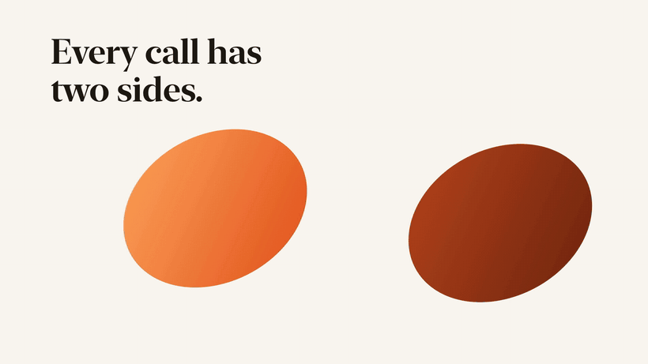

<p align="center"></p>

<h1 align="center">Granula</h1>

<p align="center"><b>Meeting notes that stay on your Mac.</b><br>
Granula records both sides of any call — without a bot joining it — transcribes them on-device<br>
and turns the conversation into one clear note: decisions, tasks, numbers.</p>

<p align="center">
<a href="LICENSE"></a>


</p>

<p align="center">
<a href="docs/granula-demo.mp4"></a><br>
<sub>▶ <a href="docs/granula-demo.mp4">Watch the 36-second film with sound</a></sub>
</p>

**No bot. No servers. No account.** Just a Mac app, two audio tracks and plain files you own.

---

## How it works

**1 · It notices the call.** When Zoom, Google Meet, Telegram, WhatsApp, FaceTime, Teams, Slack,
Discord or any browser call holds the microphone for a few seconds, a small panel asks
*Record the meeting?* — one click and you are recording. When the call ends, recording stops on its own.
Or press **⌥⌘R** anywhere.

**2 · Me from the mic. Them from the call.** Granula records two separate tracks: **Me** (your
microphone) and **Them** (the sound of the call app, captured with a Core Audio process tap).
Nobody joins your call, and every phrase knows who said it. On speakers, your mic hears the other
side too — Granula drops those echoes so each phrase is attributed once.

**3 · Transcribed on your Mac.** [Parakeet TDT 0.6B v3](https://huggingface.co/FluidInference/parakeet-ultra-coreml)
runs on Core ML through [FluidAudio](https://github.com/FluidInference/FluidAudio): an hour of audio in
about 10 seconds, and the audio never leaves the Mac. Strong on Russian, Ukrainian and English —
including English mixed into Russian or Ukrainian in one sentence.

**4 · Two sides, one note.** The summary is written in the language of the conversation: gist,
decisions, tasks as *who — what — when*, open questions and key numbers. Your own notes from the
call go in too. Summary templates are plain markdown files you can edit.

**5 · Plain files, yours to keep.** One folder per meeting in `~/Documents/Granula/` (or any folder
you pick in **Meetings folder…**): compressed audio, `transcript.md`, `summary.md`, your `notes.md`
and `meeting.json`. Open them in any editor, sync them, grep them.

### Also

- **Knows your calendar.** Upcoming meetings for the next 5 days, a reminder a minute before each one,
  and every recording made during a meeting takes its title and participants. Read-only access.
- **Speaks four languages.** Interface in English, Russian, Ukrainian and Spanish.

## Privacy

Recording and transcription are fully local. The only thing that leaves the Mac is the
**transcript text** when you generate a summary: Granula passes it to the
[Claude Code](https://claude.com/claude-code) CLI you are already signed in to
(`claude -p --model sonnet`). No Claude CLI — no summaries, everything else still works.
Granula has no servers, accounts or telemetry.

## Requirements

- macOS 14.4 or newer (system-audio capture needs process taps), Apple Silicon recommended.
- Xcode 26 / Swift 6.2 toolchain to build.
- Optional: the `claude` CLI on `PATH` for AI summaries.
- About 600 MB of disk for the speech model, downloaded on first launch.

## Build and run

```bash
git clone https://github.com/nahornyi-ai-lab/granula.git
cd granula
scripts/build-app.sh --install   # builds Granula.app and copies it to /Applications
```

On first launch Granula walks you through three permissions: **Microphone**, **System Audio
Recording** and **Calendars**.

> **Signing.** `build-app.sh` signs with your *Apple Development* certificate when you have one.
> Without it the app is signed ad-hoc, and macOS asks for the permissions again after every rebuild.
> Set `GRANULA_SIGN_IDENTITY` to choose a specific identity.

Tests: `swift test`. The pipeline test needs the FLEURS clips from the benchmark —
run `bench/scripts/setup.sh` first.
End-to-end scripts that drive the real app live in [`scripts/e2e/`](scripts/e2e/).

## Why Parakeet

Before writing the app we measured 17 configurations of 7 speech-to-text engines on Russian, Ukrainian and English —
clean speech, call-quality audio, long recordings and code-switching (Russian/Ukrainian + English
in one sentence). Parakeet TDT v3 Ultra was the only engine that stayed accurate on all three
languages *and* on mixed speech, while transcribing an hour of audio in about 10 seconds.

| WER, lower is better | call ru | call uk | call en | mixed ru+en | mixed uk+en | speed |
|---|---|---|---|---|---|---|
| **Parakeet TDT v3 Ultra** | **6.3%** | **10.1%** | **5.7%** | **18.3%** | **18.7%** | ~400× real time |
| Whisper large-v3 turbo | 4.7% | 6.9% | 5.1% | 40.6% | 44.6% | slower, drifts on long audio |
| Apple on-device dictation | 11.0% | 15.0% | 13.3% | 63.5% | 53.0% | fast |

Full results, scripts and the method: [`bench/`](bench/) and
[`bench/results/score_report.md`](bench/results/score_report.md).

## Project layout

```
Sources/GranulaCore   recording, call detection, calendar, transcription, echo filter, summaries, storage
Sources/Granula       SwiftUI app: home screen, meeting view, menu bar, call panel, onboarding
Resources             icon, Info.plist, translations (en, ru, uk, es)
scripts               app build, icon render, string checks, end-to-end tests
bench                 speech-to-text benchmark
```

Interface strings are written in Russian in code and serve as translation keys;
`scripts/check-strings.py` checks that every key has an English, Ukrainian and Spanish translation.

## Status

Alpha. Built for its author's own meetings and used daily, but not yet notarized and not
distributed as a binary — build from source.

## Credits

Granula stands on [amanu](https://github.com/gsamat/amanu) (MIT) for system-audio capture and the
echo filter, and on [FluidAudio](https://github.com/FluidInference/FluidAudio) (Apache-2.0) for
on-device speech recognition. Details in [THIRD-PARTY-NOTICES.md](THIRD-PARTY-NOTICES.md).

From the makers of [Vepol](https://github.com/nahornyi-ai-lab/vepol) — a local AI partner that plans
your day and keeps an auditable markdown trail.

## License

[MIT](LICENSE) © 2026 Nahornyi AI Lab
