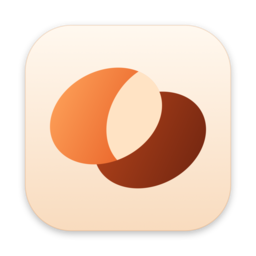

<p align="center"></p>

<h1 align="center">Granula</h1>

<p align="center"><b>Be in the call. Granula takes the notes.</b><br>
Even when the call is in a language you are still learning.</p>

<p align="center">A free, open-source AI notetaker for Mac. It hears both sides of any call without a bot joining,<br>
shows every phrase live with a translation into your language, suggests what to say when it is your turn,<br>
and when the call ends leaves one clear note: what was decided, who does what, by when.<br>
Recording, transcription and translation stay on your Mac.</p>

<p align="center">
<a href="LICENSE"></a>


</p>

<p align="center">
<a href="docs/granula-demo.mp4"></a><br>
<sub>▶ <a href="docs/granula-demo.mp4">Watch the 36-second film with sound</a></sub>
</p>

<p align="center"><b>No bot in the call · No audio in the cloud · No account · Free and open source</b></p>

---

## Granula is for you if

- **You would rather listen than type.** Granula notices the call, asks once, and stops when the call
  ends. Shortly after, the note is there.
- **Your calls are confidential.** Clients, contracts, health, money: the audio and the transcript
  never leave your Mac.
- **A bot in the call feels wrong.** Nobody sees *"Notetaker has joined the meeting"*. Granula
  records your Mac, not the meeting.
- **Your calls mix languages.** English terms in the middle of a sentence in another language, the way
  international teams really talk. On mixed speech Granula gets about 19% of words wrong; Whisper gets
  45% ([benchmark](#why-parakeet)).
- **Some calls are not in your language.** The Live window floats over Zoom or Meet and puts a
  translation under every phrase about a second after it is said.
- **You want a prompt when it is your turn.** When the other side asks you something, a suggested
  reply appears next to the transcript a few seconds after they stop — in their language, with a translation
  into yours. Optional, with your own OpenRouter key.
- **You want notes you own.** Plain Markdown in a folder you pick: open it in Obsidian, sync it,
  grep it, or let Claude Code read it.

## What you get from every call

A note written in the language of the conversation. With the default **Auto** template it looks like this
(an example):

```markdown
## Gist
The client agreed to a three-month pilot for the support team, starting 1 December.
Price is settled; the CRM integration is still open.

## Decisions
- Pilot: 3 months, 20 seats
- Weekly check-in on Tuesdays

## Tasks
- Me — send the contract — Friday
- Anna — confirm the start date with IT — next week

## Open questions
- Who owns the integration with their CRM?

## Key numbers and facts
- €1,200 a month for the pilot; full rollout quoted at 120 seats
```

Next to it, in one folder per meeting: the compressed audio, `transcript.md` with **Me** and **Them**
on every line, your own `notes.md`, and, with translation on, `transcript.translated.md`.
Other templates — **Negotiation**, **1:1**, **General meeting** — are Markdown files you can edit or add to.

## How it works

**1 · It notices the call.** When Zoom, Google Meet, Teams, Slack, Telegram, WhatsApp, FaceTime,
Discord or a call in the browser holds the microphone for a few seconds, a small panel asks
*Record the meeting?* One click and you are recording. When the call ends, recording stops on its own.
Or press **⌥⌘R** anywhere.

**2 · Me and Them, on separate tracks.** Your microphone is **Me**; the sound of the call app is
**Them**, captured with a Core Audio process tap. Every phrase knows who said it. On speakers, your
mic hears the other side too — Granula drops those echoes so each phrase is attributed once.

**3 · Live, as it is said — and translated.** The **Live window** floats over the call with the
conversation so far: each phrase appears about a second after the speaker pauses. Pick
**From → To** in its header — say Spanish → English or English → Spanish — and every line shows the
original small with the translation under it, made on the Mac by macOS's own translation models
(macOS 26+). Lines already in your language stay as they are.

**4 · A hint when it is your turn (optional).** Add an [OpenRouter](https://openrouter.ai) key in
**Hints…**; the lightbulb in the Live window shows or hides the hints column. When the other side stops talking, a decision
model (Bison by default) answers one question in a fraction of a second: does this expect a reply from
you? Only on yes, Claude Haiku writes what you can say — one to three sentences in the speaker's
language, using only the conversation, your notes and what you wrote in **About me**, with a
translation under it. *"Okay, got it"* gets no hint; *"Tell me about your timeline"* does, even
without a question mark.

**5 · Transcribed on your Mac.** After the call, [Parakeet TDT 0.6B v3](https://huggingface.co/FluidInference/parakeet-ultra-coreml)
rebuilds the transcript from the full recording on Core ML through
[FluidAudio](https://github.com/FluidInference/FluidAudio): an hour of audio in about 10 seconds.

**6 · One note.** The summary keeps the gist, decisions, tasks as *who — what — when*, open
questions and key numbers, and folds in what you typed during the call.

### Also

- **Knows your calendar.** Upcoming meetings for the next 5 days, a reminder a minute before each one,
  and every recording made during a meeting takes its title and participants. Read-only access.
- **Many languages.** Speech in 25 European languages (Parakeet v3), English and Spanish among them.
  Translation into 20 languages, Chinese, Japanese, Korean and Arabic among them.

## What runs where

| Step | Where it happens |
|---|---|
| Recording both sides of the call | Your Mac |
| Transcription, live and after the call | Your Mac (Parakeet on Core ML) |
| Translation | Your Mac (Apple's on-device translation, macOS 26+) |
| Hints (optional, off without a key) | [OpenRouter](https://openrouter.ai) with your own API key: the decision model `baseten/bison-1` and Claude Haiku 5.5, both changeable. Sent after every turn of the other side: the conversation text and "About me", for the yes/no decision; for each hint also the meeting title, attendee names and your notes. Never audio. The key is kept on this Mac in a file only your account can read (`~/Library/Application Support/Granula`), never in the log. |
| Summary | Claude, through the [Claude Code](https://claude.com/claude-code) CLI you are signed in to (`claude -p --model sonnet`). Only the transcript text is sent. |
| Storage | Plain files in `~/Documents/Granula/` or any folder you pick in **Meetings folder…** |

Granula has no servers, accounts or telemetry. No Claude CLI — no summaries; everything else still works.

### Granula and Granola

Granola is the AI notepad many people know. Here is how the two differ, by Granola's own public pages
as of November 2026:

| | **Granula** | Granola |
|---|---|---|
| Bot in the call | No | No |
| Your audio | Transcribed on your Mac, never uploaded | Sent to cloud transcription (Deepgram, AssemblyAI), then deleted |
| Your notes | Plain Markdown files on your Mac | Granola's cloud (AWS, United States) |
| Price | Free | Free plan; Business from $14 per user a month |
| Source code | Open, MIT | Closed |
| Platforms | macOS | Mac, Windows, iPhone, Android |

Sources: [where Granola runs](https://www.granola.ai/blog/local-first-ai-notetaker-vs-cloud),
[security](https://www.granola.ai/security), [pricing](https://granola.ai/blog/granola-pricing-plans-features-roi).

## Install

**Download** (Apple Silicon only). Get `Granula.zip` from the [latest release](https://github.com/nahornyi-ai-lab/granula/releases/latest),
unzip it and move **Granula** to **Applications**. Granula is alpha and not notarized by Apple yet, so
the first time macOS refuses to open it: open **System Settings → Privacy & Security**, scroll down and
click **Open Anyway** next to Granula. You do this once per version; macOS also asks again for the
microphone and system audio.

**Build from source.**

Requirements:

- macOS 14.4 or newer (system-audio capture needs process taps), Apple Silicon recommended.
- Xcode 26 / Swift 6.2 toolchain to build.
- About 600 MB of disk for the speech model, downloaded on first launch.
- Optional: the `claude` CLI on `PATH` for AI summaries.
- For translation: macOS 26 or newer, and the language packs, downloaded once in **Translation…**.

```bash
git clone https://github.com/nahornyi-ai-lab/granula.git
cd granula
scripts/build-app.sh --install   # builds Granula.app and copies it to /Applications
```

On first launch Granula walks you through three permissions: **Microphone**, **System Audio
Recording** and **Calendars**.

> **Signing.** `build-app.sh` signs with your *Apple Development* certificate when you have one.
> Without it the app is signed ad-hoc, and macOS asks for the permissions again after every rebuild.
> Set `GRANULA_SIGN_IDENTITY` to choose a specific identity.

Tests: `scripts/test.sh` (it also works with Command Line Tools alone, without Xcode; the
XCTest suites then are skipped). The pipeline test needs the FLEURS clips from the benchmark —
run `bench/scripts/setup.sh` first; the live model test needs the downloaded speech model.
End-to-end scripts that drive the real app live in [`scripts/e2e/`](scripts/e2e/).

## Why Parakeet

Before writing the app we measured 17 configurations of 7 speech-to-text engines on clean speech,
call-quality audio, long recordings and code-switching — English mixed into a sentence in another
language. Parakeet TDT v3 Ultra was the only engine that stayed accurate on single-language *and*
mixed speech, while transcribing an hour of audio in about 10 seconds.

| WER, lower is better | call, English | call, Ukrainian | mixed Ukrainian + English | speed |
|---|---|---|---|---|
| **Parakeet TDT v3 Ultra** | **5.7%** | **10.1%** | **18.7%** | ~400× real time |
| Whisper large-v3 turbo | 5.1% | 6.9% | 44.6% | slower, drifts on long audio |
| Apple on-device dictation | 13.3% | 15.0% | 53.0% | fast |

Full results, scripts and the method: [`bench/`](bench/) and
[`bench/results/score_report.md`](bench/results/score_report.md).

## Why I built Granula

I'm **Vadym Nahornyi**, an AI engineer in Valencia, Spain. At [Nahornyi AI Lab](https://nahornyi.ai)
I build AI agents and process automation for businesses, so my days are calls with clients.
Those calls run in several languages and often switch mid-sentence, and more and more of them are
in Spanish. I wanted notes from all of them without sending my clients' conversations to someone
else's cloud — and Whisper-based tools got more than four words in ten wrong on mixed speech. So I
measured seven speech engines, kept the one that held up, and built the app around it. Then came
live translation, for calls where not everyone speaks the same language. I use Granula for my own
meetings every day.

If Granula saves you a page of notes, a ⭐ helps other people find it. Bugs and ideas:
[open an issue](https://github.com/nahornyi-ai-lab/granula/issues).
Me elsewhere: [nahornyi.ai](https://nahornyi.ai) ·
[LinkedIn](https://www.linkedin.com/in/vadym-nahornyi-3b2959158) ·
[Vepol](https://github.com/nahornyi-ai-lab/vepol), my local AI partner that plans your day and keeps
an auditable Markdown trail.

## Project layout

```
Sources/GranulaCore   recording, call detection, calendar, transcription, live transcript and translation,
                      echo filter, summaries, storage
Sources/Granula       SwiftUI app: home screen, meeting view, Live window, menu bar,
                      call panel, onboarding, translation settings
Resources             icon, Info.plist, interface translations
scripts               app build, icon render, string checks, end-to-end tests
bench                 speech-to-text benchmark
```

Interface strings are written in English in code and serve as translation keys;
`scripts/check-strings.py` checks that every key is translated into every interface language.

## Credits

Granula stands on [amanu](https://github.com/gsamat/amanu) (MIT) for system-audio capture and the
echo filter, and on [FluidAudio](https://github.com/FluidInference/FluidAudio) (Apache-2.0) for
on-device speech recognition. Details in [THIRD-PARTY-NOTICES.md](THIRD-PARTY-NOTICES.md).

## License

[MIT](LICENSE) © 2026 Nahornyi AI Lab
